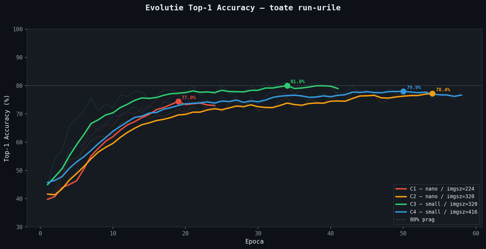
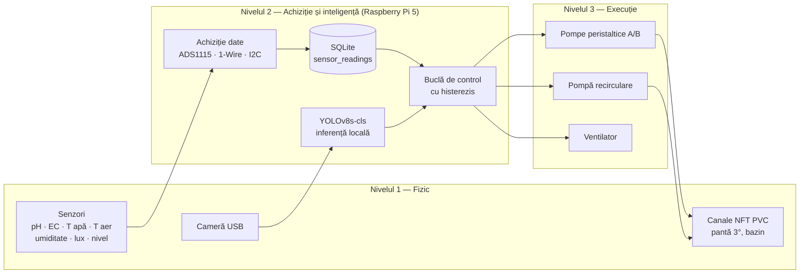

# Utilizarea Edge AI în managementul autonom al culturilor NFT

**Proiect de diplomă** — Universitatea „Ștefan cel Mare" din Suceava, Facultatea de Inginerie Electrică și Știința Calculatoarelor, programul *Automatică și Informatică Aplicată*, anul universitar 2025–2026.

| | |
|---|---|
| **Autor** | Iustin Iulian Dodiță |
| **Coordonator științific** | Ș.l. dr. ing. Corneliu Buzduga |
| **Domeniu** | Edge AI · viziune artificială · agricultură hidroponică · sisteme embedded |
| **Platformă țintă** | Raspberry Pi 5 |

Acest depozit conține codul sursă, seturile de date, experimentele de antrenare și documentația tehnică ce însoțesc lucrarea de diplomă. Structura urmează capitolele lucrării, astfel încât orice rezultat raportat poate fi regăsit și reprodus.

> **Abstract (EN).** This repository accompanies a bachelor's thesis on an autonomous Nutrient Film Technique (NFT) hydroponic system for basil (*Ocimum basilicum*). A Raspberry Pi 5 monitors seven agronomic parameters (pH, EC, water and air temperature, humidity, light, reservoir level), drives nutrient-dosing pumps and ventilation in a closed loop, and runs a YOLOv8s-cls classifier on-device to recognise three plant-health states: healthy, *Fusarium oxysporum* and *Oidium belbahrii* (powdery mildew). Everything runs offline, with no cloud dependency.

---

## Cuprins

- [Rezumat](#rezumat)
- [Rezultate principale](#rezultate-principale)
- [Arhitectura sistemului](#arhitectura-sistemului)
- [Structura depozitului](#structura-depozitului)
- [Pornire rapidă](#pornire-rapidă)
- [Corespondență teză ↔ depozit](#corespondență-teză--depozit)
- [Lucrul cu asistenți AI (dev-pack)](#lucrul-cu-asistenți-ai-dev-pack)
- [Citare și licență](#citare-și-licență)

---

## Rezumat

Lucrarea descrie proiectarea, implementarea și validarea unui sistem hidroponic autonom de tip NFT pentru busuioc, care integrează diagnosticul fitosanitar prin Edge AI. Sistemul:

1. **monitorizează** șapte parametri agronomici prin senzori dedicați (pH-4502C, EC/TDS, DS18B20, DHT22, BH1750, senzor de nivel), cu stocare locală în SQLite;
2. **controlează** chimia soluției nutritive și microclimatul printr-o buclă închisă cu histerezis (pompe peristaltice de dozare A/B, pompă de recirculare, ventilator);
3. **diagnostichează** starea frunzelor cu un clasificator YOLOv8s-cls rulat local pe Raspberry Pi 5, fără conexiune la Internet.

## Rezultate principale

| Experiment | Model | imgsz | Top-1 (val) | Top-1 (test) | Observații |
|---|---|---|---|---|---|
| C1 | yolov8n-cls | 224 | 76,95% | — | overfitting sever (batch 128) |
| C2 | yolov8n-cls | 320 | 78,44% | — | regularizare: dropout, label smoothing, cosine LR |
| **C3** | **yolov8s-cls** | **320** | **81,04%** | **85,82%** | **modelul raportat în teză** |
| C4 | yolov8s-cls | 416 | 79,93% | — | LR mai mic, regularizare mai puternică |
| C5 | yolov8s-cls | 416 | 86,74% | 85,06% | după teză, pe setul de date extins (+392 cadre proprii) |

- C1–C4: setul Roboflow (1.344 imagini, împărțite 941/269/134). C5: setul extins (1.736 imagini, 1.215/347/174). Rezultatele C3 și C5 pe test **nu sunt direct comparabile**: seturile de test diferă.
- Detecția cu bounding boxes generice (YOLOv8n-det) a obținut mAP50 ≈ 0,65 pe validare. Teza raportează mAP50 = 45,98% pe setul de test. Plafonul vine de la adnotările care acoperă imaginea întreagă.
- Pe Raspberry Pi 5 (CPU, PyTorch) modelul C5 atinge **85,06% Top-1** pe setul de test, la **~258 ms/cadru**.
- **Limitarea principală** este decalajul de domeniu: pe cadre video reale, plantele sănătoase sunt clasificate ca *Fusarium*. Canalul verde este cu ~29 de niveluri mai scăzut decât în setul de antrenare.

Detalii, metodologie și erate: [`docs/model-ai.md`](docs/model-ai.md) · [`docs/rezultate.md`](docs/rezultate.md).

<p align="center">
  
  <br><em>Fig. 4.1 din teză — evoluția acurateței Top-1 în experimentele C1–C4 (EMA, α = 0,3).</em>
</p>

## Arhitectura sistemului

Sistemul este organizat pe trei niveluri funcționale (teză, Cap. 2.3):



Arhitectura detaliată, cerințele funcționale și non-funcționale și schema bazei de date sunt în [`docs/arhitectura.md`](docs/arhitectura.md). Componentele hardware și cablajul sunt în [`docs/hardware.md`](docs/hardware.md).

## Structura depozitului

```
sera-hidroponica/
├── README.md                  ← acest document
├── AGENTS.md / CLAUDE.md      ← context pentru asistenți AI (vezi dev-pack/)
├── docs/                      ← documentația tehnică, organizată pe capitolele tezei
│   ├── arhitectura.md         ← cerințe, arhitectură pe 3 niveluri, stiva software, SQLite
│   ├── hardware.md            ← componente, cablaj, pini GPIO, calibrare
│   ├── model-ai.md            ← set de date, metodologie, experimentele C1–C5 și D1–D2
│   ├── rezultate.md           ← evaluare, decalaj de domeniu, limitări, erate
│   ├── reproducibilitate.md   ← pașii de reproducere a fiecărui rezultat
│   └── figures/               ← figurile din teză (generate din experiments/)
├── src/
│   ├── training/              ← antrenare, evaluare, raport grafic (Anexele C, D, F)
│   ├── data/                  ← construire și verificare seturi de date
│   ├── edge/                  ← inferență, bază de date, control, export ONNX (Anexele E, G, H, I)
│   └── calibration/           ← calibrare senzori pH și EC (Anexele J, K)
├── data/                      ← seturile de date (clasificare + detecție), cu fișă descriptivă
├── experiments/               ← run-urile de antrenare (args.yaml, results.csv, grafice, weights)
├── models/                    ← modelele finale pregătite pentru deployment (C3, C5)
├── tools/                     ← verificarea mediului de lucru
├── dev-pack/                  ← metoda de lucru cu asistenți AI: context, convenții, prompturi
└── archive/                   ← scripturi exploratorii din fazele inițiale (nu fac parte din teză)
```

## Pornire rapidă

```bash
git clone https://github.com/Iustin02/sera-hidroponica.git
cd sera-hidroponica
python3 -m venv .venv && source .venv/bin/activate
pip install -r requirements.txt
python tools/setup_check.py
```

Reproducerea rezultatului din teză (C3) pe setul de test:

```bash
python src/training/evaluate_classification.py --weights models/basil_health_c3.pt --imgsz 320 --subset roboflow
```

Inferență pe o imagine:

```bash
python src/edge/inference_rpi5.py --weights models/basil_health_c3.pt --imgsz 320 --source cale/catre/frunza.jpg
```

Instalarea pe Raspberry Pi 5, reantrenarea și exportul ONNX sunt descrise în [`docs/reproducibilitate.md`](docs/reproducibilitate.md).

## Corespondență teză ↔ depozit

| Teză | Conținut | În depozit |
|---|---|---|
| Cap. 1 | Fundamentare teoretică (NFT, homeostazia soluției, Edge AI) | [`docs/arhitectura.md`](docs/arhitectura.md#1-context) |
| Cap. 2 | Cerințe și arhitectura pe trei niveluri | [`docs/arhitectura.md`](docs/arhitectura.md) |
| Cap. 3 | Implementarea hardware | [`docs/hardware.md`](docs/hardware.md) |
| Cap. 4.1–4.2 | Stiva software, baza de date | [`docs/arhitectura.md`](docs/arhitectura.md#5-stiva-software), [`src/edge/database.py`](src/edge/database.py) |
| Cap. 4.3 | Modelul YOLOv8s-cls, experimentele C1–C4 | [`docs/model-ai.md`](docs/model-ai.md), [`experiments/`](experiments/) |
| Cap. 5 | Testare, validare, decalaj de domeniu | [`docs/rezultate.md`](docs/rezultate.md) |
| Anexa A, G | Schema SQLite și popularea ei | [`src/edge/database.py`](src/edge/database.py) |
| Anexa B | Istoricul antrenării | [`docs/model-ai.md`](docs/model-ai.md) |
| Anexa C | Scriptul de antrenare | [`src/training/train_classification.py`](src/training/train_classification.py) |
| Anexa D | Matricea de confuzie | [`src/training/evaluate_classification.py`](src/training/evaluate_classification.py) |
| Anexa E | Inferență pe Raspberry Pi 5 | [`src/edge/inference_rpi5.py`](src/edge/inference_rpi5.py) |
| Anexa F | Netezire EMA și grafice | [`src/training/generate_training_report.py`](src/training/generate_training_report.py) |
| Anexa H | Export ONNX | [`src/edge/export_onnx.py`](src/edge/export_onnx.py) |
| Anexa I | Bucla de control | [`src/edge/control_loop.py`](src/edge/control_loop.py) |
| Anexa J, K | Calibrarea pH și EC | [`src/calibration/`](src/calibration/) |

## Lucrul cu asistenți AI (dev-pack)

Depozitul este pregătit pentru dezvoltare asistată de AI (Claude Code, Codex, Cursor, GitHub Copilot). [`AGENTS.md`](AGENTS.md) este punctul de intrare comun pentru toate aceste unelte. Folderul [`dev-pack/`](dev-pack/) conține:

- contextul condensat al proiectului, cu valorile de referință care nu trebuie modificate;
- convențiile de cod și protocolul de documentare a experimentelor;
- prompturi reutilizabile pentru sarcini frecvente: experiment nou, deployment pe Pi, senzor nou, actualizarea documentației, review;
- checklisturi de verificare înainte de commit.

Fluxul recomandat este descris în [`dev-pack/README.md`](dev-pack/README.md).

## Citare și licență

Dacă folosești acest proiect, citează-l cu ajutorul [`CITATION.cff`](CITATION.cff) (butonul *Cite this repository* de pe GitHub):

> Dodiță, I. I. (2026). *Utilizarea Edge AI în managementul autonom al culturilor NFT* [Proiect de diplomă, Universitatea „Ștefan cel Mare" din Suceava]. https://github.com/Iustin02/sera-hidroponica

- **Cod sursă:** licența MIT, vezi [`LICENSE`](LICENSE).
- **Set de date:** imaginile Roboflow provin din *Basil Health Detection* (Roboflow Universe) și rămân sub licența publicată de autorii lor. Cadrele `hq_frame_*` sunt înregistrări proprii. Detalii în [`data/README.md`](data/README.md).
