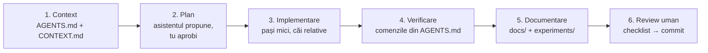

# dev-pack — dezvoltare asistată de AI

Dev-pack-ul este setul de fișiere prin care un asistent AI (Claude Code, Codex, Cursor, Copilot etc.) primește contextul corect al proiectului și lucrează după aceleași reguli ca autorul. Fără el, un asistent pornește „la rece”: ghicește structura, inventează cifre sau modifică fișiere care trebuie să rămână neschimbate.

## Conținut

| Fișier | Rol |
|---|---|
| [`../AGENTS.md`](../AGENTS.md) | punctul de intrare, citit automat de majoritatea uneltelor |
| [`CONTEXT.md`](CONTEXT.md) | faptele proiectului: cifre de referință, invarianți, decizii și motivele lor |
| [`CONVENTIONS.md`](CONVENTIONS.md) | stilul de cod, structura, protocolul pentru experimente și pentru documentație |
| [`prompts/`](prompts/) | prompturi reutilizabile pentru sarcinile frecvente |
| [`checklists/`](checklists/) | verificări înainte de commit și după un experiment |

Integrarea cu unelte specifice:

| Unealtă | Fișier citit automat |
|---|---|
| Claude Code | `CLAUDE.md` (importă `AGENTS.md`) + comenzi în `.claude/commands/` |
| OpenAI Codex, Cursor, Aider și altele | `AGENTS.md` |
| GitHub Copilot | `.github/copilot-instructions.md` |

## Fluxul de lucru

1. **Context.** Pornește sesiunea din rădăcina depozitului. Asistentul citește `AGENTS.md`, iar pentru orice sarcină netrivială îi ceri explicit să citească și `dev-pack/CONTEXT.md`.
2. **Plan.** Pentru modificări în `src/edge/`, `docs/` sau pe date, cere întâi un plan. Respinge planurile care ating `experiments/` sau `data/` fără motiv.
3. **Implementare.** Folosește un prompt din `prompts/` ca punct de plecare și completează câmpurile marcate `<...>`.
4. **Verificare.** Asistentul rulează comenzile de verificare și raportează rezultatul real, nu pe cel așteptat.
5. **Documentare.** Un experiment nou nu este terminat până nu apare în `experiments/README.md` și `docs/model-ai.md`. Pentru o schimbare hardware se actualizează `docs/hardware.md`.
6. **Review uman.** Parcurgi [`checklists/pre-commit.md`](checklists/pre-commit.md). Commit-ul îl faci tu sau îl ceri explicit.

## Prompturi disponibile

| Prompt | Când îl folosești |
|---|---|
| [`new-experiment.md`](prompts/new-experiment.md) | antrenezi o variantă nouă de model |
| [`deploy-pi.md`](prompts/deploy-pi.md) | instalezi sau actualizezi sistemul pe Raspberry Pi 5 |
| [`add-sensor.md`](prompts/add-sensor.md) | integrezi un senzor sau actuator nou |
| [`update-docs.md`](prompts/update-docs.md) | sincronizezi documentația cu codul sau cu rezultatele |
| [`code-review.md`](prompts/code-review.md) | ceri o revizuire critică a unei modificări |

## Bune practici

- **Un subiect pe sesiune.** Contextul lung degradează calitatea. Pentru o sarcină nouă, pornește o sesiune nouă.
- **Cere dovezi.** Pentru „acuratețea a crescut” cere ieșirea lui `evaluate_classification.py`.
- **Asistentul nu are acces la hardware.** Pe Pi, comenzile reale le rulezi tu. Asistentul pregătește scripturile, care rulează implicit în `--dry-run`.
- **Păstrează CONTEXT.md la zi.** Când o decizie se schimbă (de exemplu, un model nou de referință), actualizează întâi `CONTEXT.md`. Toate sesiunile următoare pornesc de la el.
