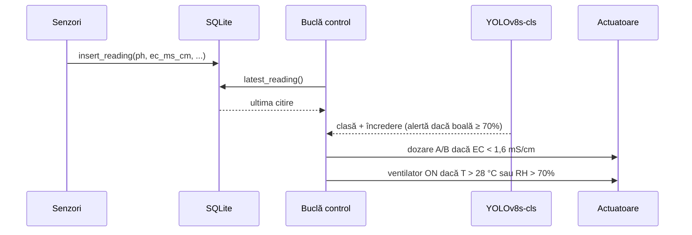

# Arhitectura sistemului

> Corespunde capitolelor 1, 2 și 4.1–4.2 din teză.

## 1. Context

**Nutrient Film Technique (NFT)** este o metodă hidroponică în care o peliculă subțire de soluție nutritivă curge continuu pe fundul unor canale ușor înclinate. Rădăcinile stau parțial în aer, ceea ce le asigură oxigenarea, și parțial în pelicula de soluție. Comparativ cu agricultura pe sol, NFT reduce consumul de apă cu 90–95%. Punctul slab este sensibilitatea la întreruperi: câteva ore fără recirculare usucă rădăcinile.

În proiect canalele au o pantă de **3°**, peste recomandarea uzuală de 1,5–2°. Panta mai mare crește viteza peliculei și oxigenul dizolvat cu aproximativ 5%.

**Homeostazia soluției nutritive.** Parametrii optimi pentru busuioc (teză, Tabelul 1.1):

| Parametru | Interval optim |
|---|---|
| pH soluție | 5,5 – 6,5 |
| Conductivitate electrică (EC) | 1,2 – 2,4 mS/cm |
| Temperatura soluției | 18 – 24 °C |
| Temperatura ambiantă | 20 – 28 °C |
| Umiditate relativă | 50 – 70% |
| Luminozitate | min. 6 h/zi, 15.000 – 40.000 lux |
| Oxigen dizolvat | > 6 mg/L |

Deficitul de presiune a vaporilor (VPD), cu un optim de 0,8–1,2 kPa pentru busuioc, se calculează din temperatură și umiditate:

```
SVP = 0,6108 · exp(17,27 · T / (T + 237,3))   [kPa]
VPD = SVP · (1 − RH / 100)
```

**Edge AI.** Datele sunt procesate pe dispozitivul fizic, nu în cloud. Avantajele sunt latența mică, faptul că datele nu părăsesc incinta și funcționarea fără Internet. Raspberry Pi 5 (Cortex-A76, 2,4 GHz, cip I/O RP1) rulează simultan achiziția, controlul și inferența.

## 2. Cerințe funcționale

| ID | Cerință |
|---|---|
| CF1 | Citirea pH, EC, temperatură apă, temperatură aer, umiditate, luminozitate și nivel bazin, cel puțin o dată pe minut |
| CF2 | Activarea automată a pompelor peristaltice pentru menținerea EC în 1,2–2,4 mS/cm |
| CF3 | Activarea automată a ventilatorului pentru umiditate < 70% și temperatură < 28 °C |
| CF4 | Controlul debitului pompei de recirculare, pentru o peliculă NFT continuă |
| CF5 | Clasificarea imaginilor foliare în 3 clase: sănătos, *Fusarium oxysporum*, *Oidium belbahrii* |
| CF6 | Stocarea tuturor citirilor în SQLite, cu marcaj de timp |
| CF7 | Generarea de alerte la detecția bolilor sau la ieșirea parametrilor din intervale |

## 3. Cerințe non-funcționale

| ID | Cerință |
|---|---|
| CNF1 | Latența inferenței AI sub 100 ms/cadru pe Raspberry Pi 5 |
| CNF2 | Izolare galvanică a senzorului de pH față de circuitul de comandă |
| CNF3 | Funcționare complet offline |
| CNF4 | Consum total al sistemului embedded sub 15 W |
| CNF5 | Rezoluție PWM de cel puțin 8 biți |

> Stadiul CNF1 este discutat în [`rezultate.md`](rezultate.md#4-performanța-pe-raspberry-pi-5): latența măsurată cu PyTorch pe CPU este de ~258 ms/cadru. Exportul ONNX este calea propusă pentru a atinge ținta.

## 4. Arhitectura pe trei niveluri

| Nivel | Rol | Componente |
|---|---|---|
| **1 — Fizic** | Interacțiunea cu mediul de cultură | canale NFT PVC 50×50 mm, bazin, senzori, cameră USB |
| **2 — Achiziție și inteligență** | Nucleul computațional (Raspberry Pi 5) | achiziție date, inferență YOLOv8s-cls, buclă de control, SQLite |
| **3 — Execuție** | Acționarea asupra mediului | 2 pompe peristaltice (nutrient A / B), pompă de recirculare, ventilator |

Fluxul unui ciclu de control (`src/edge/control_loop.py`, implicit la 30 s):



Pompele de dozare sunt separate (A: azot și calciu; B: fosfor, potasiu și oligoelemente). Separarea evită precipitarea fosfatului de calciu în soluția concentrată.

## 5. Stiva software

| Componentă | Tehnologie |
|---|---|
| Sistem de operare | Raspberry Pi OS 64-bit (Debian) |
| Limbaj | Python 3.11+ |
| ML | PyTorch 2.x, Ultralytics YOLOv8 |
| Procesare imagini | OpenCV 4.x |
| Bază de date | SQLite 3 (`sqlite3` din biblioteca standard) |
| GPIO / PWM | `gpiozero` / `lgpio` |
| ADC | `adafruit-circuitpython-ads1x15` (ADS1115) |
| Dashboard / notificări (propus în teză) | Node-RED, MQTT (Mosquitto) |

## 6. Baza de date

Schema completă este definită în [`src/edge/database.py`](../src/edge/database.py) (teză, Anexa A). Tabele:

- `plants` — plantele cultivate (`name` unic, `species`, `notes`);
- `sensor_readings` — câte o citire periodică per rând, cu `reading_at` indexat și cheie străină spre `plants`.

Coloanele de măsură din `sensor_readings` au constrângeri `CHECK`, care resping valorile fizic imposibile:

| Coloană | Unitate | Domeniu valid |
|---|---|---|
| `ph` | — | 0 – 14 |
| `ec_ms_cm` | mS/cm | 0 – 10 |
| `water_temp_c` | °C | 0 – 40 |
| `ambient_temp_c` | °C | −10 – 50 |
| `humidity_pct` | % | 0 – 100 |
| `light_lux` | lux | 0 – 100.000 |
| `water_level_pct` | % | 0 – 100 |

La o citire pe minut, dimensiunea estimată este de ~150 MB pe an. Fișierul bazei de date (`date/sera_hidroponica.db`) este exclus din git.
