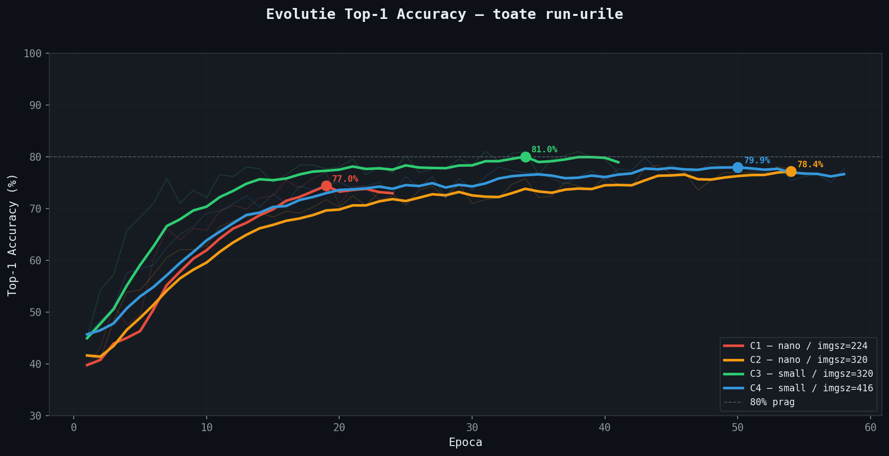
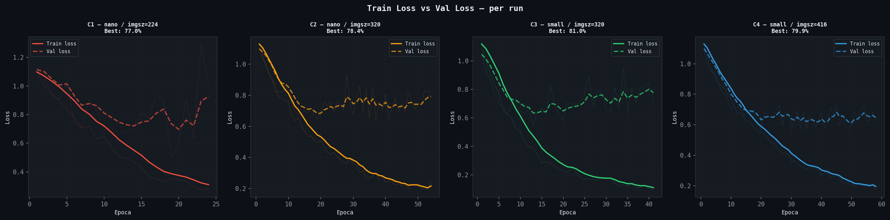
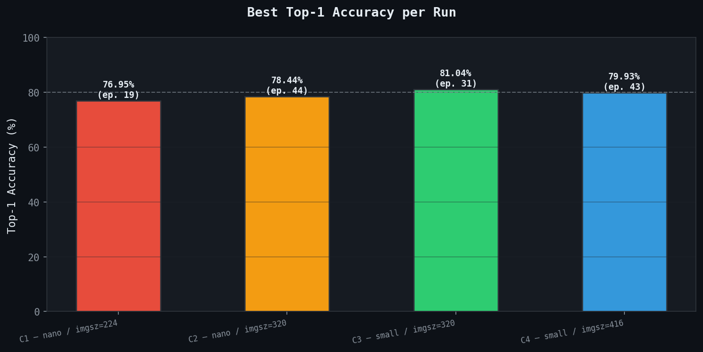
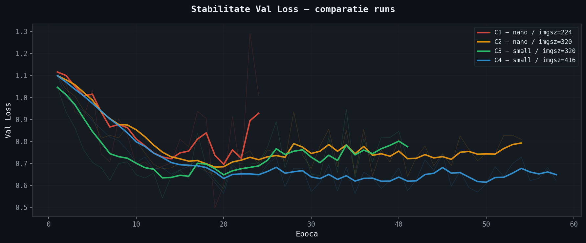

# Modelul de inteligență artificială

> Corespunde capitolului 4.3 și anexelor B–D și F din teză. Toate valorile de mai jos se regăsesc în `experiments/*/args.yaml` și `experiments/*/results.csv`.

## 1. Formularea problemei

Problema este o **clasificare la nivel de imagine** în trei stări fitosanitare ale busuiocului (*Ocimum basilicum*):

| Index model | Folder | Stare | Acțiune recomandată |
|---|---|---|---|
| 0 | `fusarium` | *Fusarium oxysporum* (fuzarioză) | alertă, izolare, verificare pH/EC |
| 1 | `healthy` | plantă sănătoasă | niciuna |
| 2 | `powdery` | *Oidium belbahrii* (făinare) | ventilație crescută, umiditate sub 60% |

> **Ordinea indicilor.** La clasificare, Ultralytics atribuie indicii în ordinea alfabetică a folderelor. Codul citește întotdeauna numele claselor din `model.names` și nu folosește indici ficși. Vezi [erata E1](rezultate.md#6-erate-față-de-textul-tezei).

## 2. Setul de date

| | Roboflow (C1–C4, teză) | Extins (C5) |
|---|---|---|
| Sursă | *Basil Health Detection* v2, Roboflow Universe | Roboflow + 392 cadre `hq_frame_*` din sera proprie |
| Total imagini | 1.344 | 1.736 |
| Train / val / test | 941 / 269 / 134 | 1.215 / 347 / 174 |
| Rezoluție medie | 392×392 px | — |
| Pre-procesare la export | niciuna | — |

Distribuția pe clase a setului extins (train / val / test): `healthy` 588/164/88 · `fusarium` 321/88/39 · `powdery` 306/95/47. Toate cele 392 de cadre HQ sunt în clasa `healthy`. Ele au fost adăugate după testul pe video din [rezultate.md §3](rezultate.md#3-decalajul-de-domeniu-video-real), ca să reducă decalajul de domeniu. Fișa completă a setului de date: [`data/README.md`](../data/README.md).

## 3. Arhitectura YOLOv8s-cls

| Parametru | Valoare |
|---|---|
| Backbone | CSP cu blocuri C2f (straturile 2, 4, 6, 8; 1/2/2/4 bottleneck-uri) |
| Parametri | 6.510.243 (5.079.043 după fuziunea Conv+BN) |
| Cost | 12,5 GFLOPs la imgsz = 320 |
| Activare | SiLU: f(x) = x · σ(x) |
| Cap de clasificare | Global Average Pooling (10×10×512 → 512) → FC 512→3 → Softmax |
| Inițializare | transfer learning, ponderi pre-antrenate pe ImageNet |
| Pierdere | Cross-Entropy (cu label smoothing 0,1 de la C2 încolo) |
| Dimensiune `best.pt` | 10,3 MB (fără starea optimizatorului) |

## 4. Mediul de antrenare

Apple MacBook Pro M1 Pro (10 nuclee, 16 GB memorie unificată), backend **MPS**, Ultralytics 8.4.66, PyTorch 2.12, Python 3.14. Configurația a folosit `workers=8`, `cache="ram"`, `amp=True`, `OMP_NUM_THREADS=8`, `seed=0` și `deterministic=True`.

## 5. Experimentele de clasificare (C1–C5)

Toate experimentele folosesc optimizatorul AdamW. Fiecare preset din [`train_classification.py`](../src/training/train_classification.py) reproduce exact configurația salvată în `args.yaml`.

| | C1 | C2 | C3 | C4 | C5 |
|---|---|---|---|---|---|
| Run | `basil_health_v1` | `basil_health_v2` | `basil_health_v3` | `basil_health_v4` | `basil_health_v4-2` |
| Model | yolov8n-cls | yolov8n-cls | yolov8s-cls | yolov8s-cls | yolov8s-cls |
| imgsz | 224 | 320 | 320 | 416 | 416 |
| batch | 128 | 32 | 32 | 32 | 32 |
| lr0 / lrf | 1e-3 / 0,01 | 3e-4 / 0,01 | 3e-4 / 0,01 | 1e-4 / 0,001 | 1e-4 / 0,001 |
| cos_lr | — | ✓ | ✓ | ✓ | ✓ |
| dropout | 0 | 0,2 | 0,2 | 0,3 | 0,3 |
| weight_decay | 5e-4 | 1e-3 | 1e-3 | 2e-3 | 2e-3 |
| warmup / patience | 3 / 5 | 3 / 10 | 3 / 10 | 5 / 15 | 5 / 15 |
| Set de date | Roboflow | Roboflow | Roboflow | Roboflow | extins |
| Epoci rulate (cea mai bună) | 24 (19) | 54 (44) | 41 (31) | 58 (43) | 97 (82) |
| **Top-1 val (cea mai bună)** | **76,95%** | **78,44%** | **81,04%** | **79,93%** | **86,74%** |

### Analiza progresiei

- **C1 → C2 (+1,49 pp).** Cu batch 128, cele 941 de imagini produceau doar 7 iterații pe epocă și un overfitting sever: train_loss 0,27 față de val_loss 1,29. Batch-ul de 32, rezoluția de 320 px și regularizarea (dropout, label smoothing, cosine LR) au stabilizat val_loss.
- **C2 → C3 (+2,60 pp).** S-a schimbat o singură variabilă, capacitatea modelului: de la nano (2,7M parametri) la small (6,5M). A fost cel mai mare câștig din serie. C3 este modelul raportat în teză.
- **C3 → C4 (−1,11 pp).** Rezoluția de 416 px, LR-ul mai mic și regularizarea mai puternică au încetinit convergența, fără câștig. Pe setul Roboflow, 320 px sunt suficienți.
- **C5.** Folosește configurația C4 pe setul extins și s-a antrenat 97 de epoci. Ajunge la 86,74% pe validare, cu cel mai mic decalaj între pierderile de antrenare și validare: 0,078 față de 0,590. Câștigul nu poate fi atribuit numai configurației, pentru că setul de validare s-a schimbat odată cu adăugarea cadrelor HQ (vezi [rezultate.md §5](rezultate.md#5-limitări-și-amenințări-la-validitate)).
- Un al șaselea run, `basil_health_v5`, a fost oprit manual după 2 epoci. Este păstrat doar pentru trasabilitate: are `args.yaml` și `results.csv`, fără weights.

Figurile 4.1–4.4 din teză se regenerează cu [`generate_training_report.py`](../src/training/generate_training_report.py). Scriptul aplică netezire EMA cu α = 0,3, la fel ca TensorBoard.

| | |
|---|---|
|  |  |
|  |  |

## 6. Ramura de detecție (D1–D2)

Pentru localizarea zonelor afectate, setul de clasificare a fost convertit în format YOLO de detecție ([`build_detection_dataset.py`](../src/data/build_detection_dataset.py)). Nu existau adnotări manuale, așa că fiecare imagine a primit un **bounding box generic centrat** (`0.5 0.5 0.85 0.85`).

| Run | Model | Modificări | Epoci | mAP50 (val, cel mai bun) |
|---|---|---|---|---|
| D1 `basil_3class` | yolov8n | configurație implicită | 25 | 0,654 |
| D2 `basil_3class_v2` | yolov8n | mosaic = 0, box = 3,0, cls = 1,5 | 10 | 0,423 |
| D2′ `basil_3class_v2-2` | yolov8n | ca D2 | 17 | 0,443 |

Concluzia: cu bbox-uri generice, detecția are un plafon structural. Modelul învață clasa, nu localizarea leziunii. Dezactivarea augmentării mosaic a eliminat principala sursă de variație și a scăzut performanța. Direcția corectă este adnotarea manuală a 300–400 de imagini, cu bbox-uri pe leziuni.

## 7. Inferență și deployment

- [`inference_rpi5.py`](../src/edge/inference_rpi5.py): cameră USB (V4L2) → clasificare → decizie. Prag de alertă: 70% încredere.
- [`export_onnx.py`](../src/edge/export_onnx.py): export ONNX (opset 12, simplificat, static), pentru `onnxruntime` pe ARM.
- Modelele pregătite pentru deployment sunt în [`models/`](../models/).
