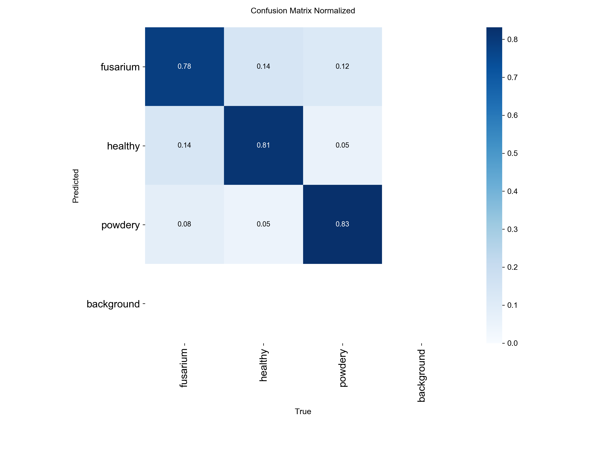

# Testare, validare și rezultate

> Corespunde capitolului 5 și concluziilor tezei. Secțiunile 1 și 4 includ și măsurători făcute după predarea lucrării. Ele sunt marcate explicit.

## 1. Evaluarea clasificatorului

Valorile au fost obținute cu [`evaluate_classification.py`](../src/training/evaluate_classification.py) (CPU, `batch=32`). Comenzile exacte sunt în [`reproducibilitate.md`](reproducibilitate.md).

| Model | Subset | Split | Imagini | Top-1 | Recall fusarium | Recall healthy | Recall powdery |
|---|---|---|---|---|---|---|---|
| C3 (`basil_health_c3.pt`, 320 px) | Roboflow | val | 269 | **81,04%** | 78,4% | 81,4% | 83,2% |
| C3 | Roboflow | test | 134 | **85,82%** | 89,7% | 81,2% | 87,2% |
| C5 (`basil_health_c5.pt`, 416 px) | extins | val | 347 | **86,74%** | 78,4% | 91,5% | 86,3% |
| C5 | extins | test | 174 | **85,06%** | 76,9% | 89,8% | 83,0% |

Top-5 este 100% în toate cazurile, ceea ce e trivial pentru trei clase.

**Interpretare.**
- Valoarea de 81,04% citată în teză este acuratețea pe **setul de validare**, cea pe care Ultralytics o raportează în `results.csv` și pe care o folosește la alegerea `best.pt`. Pe setul de test, separat, C3 obține 85,82% (vezi [erata E2](#6-erate-față-de-textul-tezei)).
- Cea mai costisitoare eroare din punct de vedere agronomic este *Fusarium* clasificat ca sănătos. La C5 pe test, 7 din 39 de imagini (18%) cad în această eroare.
- C3 și C5 au rezultate apropiate pe test, dar pe seturi diferite, deci nu se poate afirma că C5 e superior. O comparație corectă cere evaluarea ambelor modele pe același set de test, fără cadrele HQ.

 <em>Anexa D — matricea de confuzie normalizată a modelului C3 (setul de validare).</em>

## 2. Detecția cu bounding boxes

Pe setul de test, detectorul YOLOv8 a obținut **mAP50 = 45,98%** (teză, Tabelul 5.2), cu ~3,5 ms/imagine pe M1 Pro (MPS). Diferența față de clasificator vine din adnotări: cu bbox-uri generice, modelul nu are informație spațială despre leziuni. Exemplele vizuale (teză, Fig. 5.1–5.3) arată casete care acoperă uniform întreaga plantă.

## 3. Decalajul de domeniu (video real)

Modelul a fost testat pe cadre extrase cu ffmpeg (`-q:v 2`) din două înregistrări făcute în sera hidroponică, cu plante sănătoase:

| Sursă | Cadre | Rezoluție | Predicție |
|---|---|---|---|
| Video comprimat (WhatsApp) | 1.344 | 478×850 | 100% *Fusarium* (încredere 0,999) |
| Video HQ | 392 | 1.072×1.904 | 98,5% *Fusarium* (încredere 0,952) |
| **Realitate** | | | **plante sănătoase** |

Analiza canalelor RGB arată un canal verde mai slab în video: media este 94, față de 123 la imaginile `healthy` din setul de date. Plantele sănătoase apar astfel mai închise și mai brune, asemănătoare frunzelor cu fuzarioză. Compresia video agravează fenomenul. Cadrele HQ au o încredere mai mică (0,952 față de 0,999), deci informația cromatică mai fidelă reduce parțial confuzia.

Soluțiile propuse în teză: (1) egalizarea adaptivă a histogramei (CLAHE) la inferență; (2) augmentări cromatice de luminozitate și saturație; (3) fine-tuning pe cadre reale etichetate. Varianta (3) a fost aplicată după teză în C5, prin cele 392 de cadre HQ etichetate `healthy`.

## 4. Performanța pe Raspberry Pi 5

> Măsurătoare făcută după predarea tezei (2026-06-28): Raspberry Pi 5, 4 GB RAM, Debian 13, CPU, ultralytics 8.4 + torch 2.12, model C5, imgsz 416.

| Metrică | Valoare |
|---|---|
| Top-1 pe setul de test (174 imagini) | **85,06%**, identic cu evaluarea pe Mac (paritate confirmată) |
| Latență | **~258 ms/cadru (~4 fps)** |
| Cameră | webcam USB pe `/dev/video0` (OpenCV, V4L2) |

Ținta CNF1 (< 100 ms/cadru) **nu este atinsă** cu PyTorch pe CPU. Teza estimase 15–30 ms/cadru. Căile de optimizare sunt exportul ONNX/onnxruntime (estimat −30…50% dimensiune și +20…40% viteză), imgsz 320 (modelul C3) și cuantizarea INT8. Pentru o seră, unde bolile evoluează în zile, 4 fps rămân suficienți funcțional.

## 5. Limitări și amenințări la validitate

1. **Dimensiunea setului de date.** 1.344–1.736 de imagini sunt puține. Setul de validare (269–347 de imagini) produce metrici zgomotoase: val_loss oscilează între 0,54 și 0,94.
2. **Posibilă scurgere de informație în C5.** Cadrele `hq_frame_*` provin dintr-un singur video și sunt împărțite aleator între train, val și test. Cadrele vecine sunt aproape identice, deci acuratețea C5 pe clasa `healthy` poate fi supraestimată. Corecția este o împărțire pe secvențe video.
3. **Clasificare, nu localizare.** O frunză cu simptome parțiale este clasificată în întregime.
4. **Validarea sistemului de monitorizare** din teză (§5.2) s-a făcut pe 30 de citiri simulate, nu pe date reale de lungă durată.
5. **Selecția modelului pe setul de validare** (early stopping, `best.pt`) face ca acuratețea de validare să fie ușor optimistă. Setul de test este estimatorul nepărtinitor.

## 6. Erate față de textul tezei

Erorile de mai jos au fost identificate la reorganizarea depozitului. Codul din depozit conține deja corecturile.

| ID | Loc în teză | Problemă | Corectură |
|---|---|---|---|
| E1 | Anexa E | Maparea fixă `{0: healthy, 1: Fusarium, 2: Oidium}` nu corespunde modelului: Ultralytics ordonează alfabetic, deci 0 = fusarium, 1 = healthy, 2 = powdery. Cu maparea din anexă, alertele s-ar declanșa pe clasa greșită. | `inference_rpi5.py` citește `model.names` |
| E2 | Tabelul 5.1, Anexa D | 81,04% și matricea de confuzie sunt pe setul de **validare** (269 de imagini), nu pe cel de test (134). Pe test, C3 obține 85,82%. | `evaluate_classification.py --split test` |
| E3 | Anexa I | Interogarea SQL folosește coloanele `ec`, `temp_air`, `timestamp`, care nu există în schema din Anexa A. Corect: `ec_ms_cm`, `ambient_temp_c`, `reading_at`. | `control_loop.py` folosește `database.latest_reading()` |
| E4 | Anexa J | Alegerea segmentului de calibrare presupune o pantă tensiune–pH negativă. Modulul folosit are pantă pozitivă, deci segmentul ales ar fi greșit. | segmentul se alege după poziția tamponului pH 4,01 |
| E5 | §4.3.9 | Textul pomenește 1.215 / 347 / 174 imagini pentru C3, dar C3 a fost antrenat pe setul Roboflow (941 / 269 / 134). Cifrele 1.215 / 347 / 174 sunt ale setului extins. | — |
| E6 | Tabelul 5.2 | Detectorul este descris ca YOLOv8s. Run-urile salvate folosesc yolov8n (`args.yaml`). | — |
| E7 | §4.3.5 | „Early stop la epoca 31": 31 este epoca celui mai bun rezultat. Antrenamentul s-a oprit la epoca 41. | — |

## 7. Concluzii

Lucrarea arată că un sistem NFT complet, cu monitorizarea a șapte parametri, control în buclă închisă și diagnostic vizual pe dispozitiv, poate fi construit cu hardware sub 300 EUR, fără dependență de cloud. Clasificatorul YOLOv8s-cls depășește pragul propus de 80% Top-1. Principalele direcții de continuare sunt reducerea decalajului de domeniu prin date reale din sera țintă, trecerea la detecție cu adnotări manuale și optimizarea inferenței (ONNX, INT8) pentru a atinge ținta de latență.
